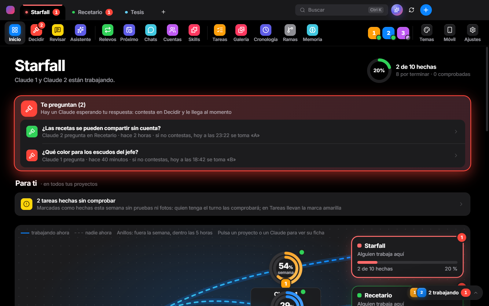

# Mission Control para Claude Code

[Read in English](README.md) · [Invítame a un café](https://buymeacoffee.com/pakitron.exe)

Una app de escritorio para Windows y macOS que coordina tus cuentas de **Claude Code** en tus proyectos: quién trabaja dónde, quién sigue cuando una se queda sin uso, qué te espera a ti y qué hicieron mientras no mirabas. Con una sola cuenta ya sirve. Con varias, cada una sigue con lo suyo y, si tú lo enciendes, se relevan entre ellas. Está en español.

## Qué necesitas

- Windows 10 u 11, o macOS 12 o posterior (Apple Silicon o Intel).
- Una cuenta de Claude con Claude Code, del plan que sea: Pro, Max, Ultra, Team, Enterprise, o pagando por uso (Console, una clave, Amazon Bedrock, Google Vertex). Claude Code solo dice cuánto uso queda en Pro, Max y Ultra: con los demás, la app sabe que se ha acabado cuando Claude Code lo avisa, y con los de pago por uso enseña el gasto de cada sesión, nunca le pregunta nada por su cuenta (cada pregunta cuesta) y no hace que sigan trabajando sin parar: sin un límite que los corte, gastarían hasta acabar el crédito.
- Nada más. Si no tienes Claude Code, la app lo instala la primera vez con su instalador oficial. Node.js no hace falta: si no está, la app usa su propio programa para las órdenes que dejan los Claude.

## Instalar

1. Descarga el instalador de [Releases](../../releases):
   - **Windows**: `Pakitron.Mission.Control.Setup.<versión>.exe`. No está firmado, así que Windows puede avisar: «Más información» › «Ejecutar de todas formas».
   - **Mac**: `Pakitron-Mission-Control-<versión>-mac-arm64.dmg` para Apple Silicon (M1 y posteriores), `…-mac-x64.dmg` para Intel. Abre el `.dmg` y arrastra la app a **Aplicaciones**. Apple no la ha notarizado, así que la primera vez: clic derecho › **Abrir** › **Abrir** (o Ajustes del Sistema › Privacidad y seguridad › **Abrir igualmente**). En Mac las ventanas de los Claude se abren en Terminal; para que la app escriba en ellas tus mensajes del móvil, permítelo en Privacidad y seguridad › **Accesibilidad**.
2. Ábrela desde el acceso directo **Pakitron Mission Control**.

Actualizar: cuando sale una versión nueva, la app lo avisa en su barra de arriba y abre el instalador de tu sistema. Se instala encima: tus datos están en su propia carpeta (`%LOCALAPPDATA%\PakitronMC` en Windows, `~/Library/Application Support/PakitronMC` en Mac) y no se pierde nada.

Desde el código: `npm install` y `npm run dist` dejan el instalador de Windows en `dist/`; en un Mac, `npm run dist:mac` deja los `.dmg`.

## La primera vez

Inicio enseña **Primeros pasos**: cuatro pasos, cada uno con su botón. La app ya ha mirado lo que hay y salta lo que esté hecho.

1. **Tus cuentas de Claude.** Si no tienes Claude Code, «Instalar Claude Code» abre su instalador en una ventana. Después, «Iniciar sesión» abre otra para entrar con tu cuenta. Si tienes más cuentas, cada una en su carpeta (`CLAUDE_CONFIG_DIR`, como `%USERPROFILE%\.claude-segunda`), la app las encuentra sola y las ofrece en **Cuentas**.
2. **Que la app vea lo que hace cada Claude.** Lo hace sola: pone en cada cuenta unos ganchos de Claude Code que le avisan de cuándo empieza, para y escribe cada sesión. Antes guarda una copia de su `settings.json`.
3. **Tu primer proyecto.** Elige la carpeta. La app reconoce qué es (un juego de Unity o Godot, una web, una app, Python, vídeo, documentos…) y la prepara para que varios Claude trabajen sin pisarse: tareas (`docs/TASKS.md`), relevo (`docs/RELEVO.md`), unas instrucciones para cada sesión en `CLAUDE.md`, y las skills y ayudantes que le sirven. Si algún Claude ya trabajó en otras carpetas, las ofrece con un clic.
4. **Quién sigue cuando uno se queda sin uso.** Al instalarla, cada cuenta sigue con lo suyo y retoma su trabajo cuando le vuelve el uso. Que se releven entre ellas (cuando una se queda sin uso, la siguiente abre su ventana y sigue donde lo dejó) viene apagado: al encenderlo en **Relevos**, la app te enseña antes lo que dicen las normas de Anthropic, que no aclaran si una persona puede juntar varias suscripciones así. Lo enciendes bajo tu responsabilidad.

## Cómo trabajan los Claude aquí

Cada Claude usa la orden `pmc`, que la app deja preparada en cualquier ventana. Con `pmc parte` sabe en qué punto está el proyecto. `pmc claim` reserva una tarea para que nadie más la haga y `pmc guarda` deja el relevo al día al cerrar cada bloque. Cuando necesita que decidas algo, `pmc decide` deja la pregunta en **Decidir** y sigue con otra cosa; si no contestas a tiempo, se queda la opción por defecto. Tú lo ves todo en la app sin abrir un archivo.

Cada proyecto que añades queda preparado para los Claude: la app ve qué tipo de proyecto es (un juego, una web, un vídeo…) y deja un `CLAUDE.md` corto con cómo se trabaja allí, unos ayudantes (para orientarse, revisar capturas, comprobar y dejar el relevo), la skill de Mission Control y qué modelo basta para cada tarea. Además busca sola en [skills.sh](https://skills.sh) las skills que le encajan, al añadirlo y una vez por semana, e Inicio te dice cuántas ha encontrado. Instalarlas es siempre un clic tuyo: una skill trabaja con todos los permisos.

## Atajos

- **Ctrl+K:** buscar en todo.
- **Ctrl+N:** nueva instrucción.
- **Ctrl +** y **Ctrl −:** tamaño de la letra.
- **En el visor de imágenes y vídeos:**
  - V mover, C punto, O círculo y F flecha.
  - Espacio reproduce o pausa.
  - `,` y `.` avanzan fotograma a fotograma (con Mayús, 1 s).
  - Esc cierra.

## Tus datos

Todo está en `%LOCALAPPDATA%\PakitronMC`, en tu PC. Cada día se hace una copia de la base de datos en `backups\`. Actualizar o desinstalar la app no borra esa carpeta. La app no tiene servidor ni cuenta propia: lo único que sale a internet es lo de siempre de Claude Code (tus conversaciones con Claude). La app en el móvil es opcional y va por tu propia red de Tailscale, cifrada y sin nada abierto a internet.

La app no abre ni guarda tus credenciales de Claude: «Iniciar sesión» abre el inicio de sesión del propio Claude Code (`claude auth login`), y Claude Code se instala y se usa tal cual lo publica Anthropic, sin cambiarlo. Cada persona usa sus propias cuentas; tu uso de Claude sigue las condiciones de Anthropic (https://code.claude.com/docs/en/legal-and-compliance).

## Para desarrollar

- `npm install`
- `npm run dev`: la app con recarga en caliente.
- `npm test` y `npx tsc --noEmit -p tsconfig.json`: pruebas y tipos.
- `npm run capturas`: todas las pantallas a tres tamaños, y dice cuáles se desbordan.
- `node scripts/demo.mjs`: la app con datos inventados (tres cuentas y tres proyectos de ejemplo) y sus capturas, para enseñarla sin los tuyos.
- `scripts\primera-vez.ps1 -Out <carpeta> -SinNada`: la app como en un PC sin nada (sin cuentas, sin Claude Code, sin Node.js), con capturas.
- `npm run dist`: el instalador.
- `npm run actualizar`: compila y la instala en tu carpeta de usuario sin pedir permisos (cierra y vuelve a abrir la app).

Cómo está hecha: `docs/ARQUITECTURA.md`.

## Apoyar

Si Mission Control te ahorra tiempo, puedes [invitarme a un café](https://buymeacoffee.com/pakitron.exe). Los avisos de fallos y las mejoras son bienvenidos.

## Licencia

Apache 2.0 (`LICENSE`). Hecha por Pakitron (`NOTICE`): puedes usarla, cambiarla y repartirla; si repartes una versión cambiada, conserva el aviso y marca lo que cambiaste.

Mission Control no es de Anthropic ni está hecha, respaldada o patrocinada por Anthropic. Claude y Claude Code son marcas de Anthropic; aquí solo se nombran para decir con qué funciona la app.
