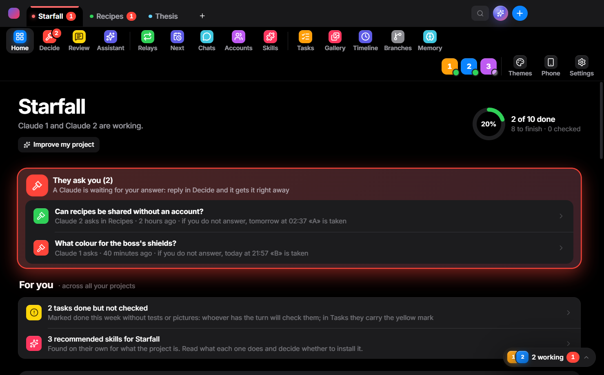
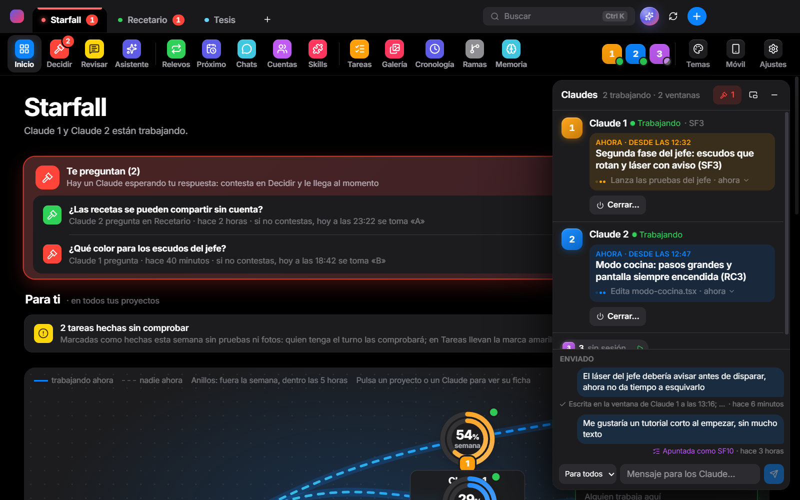
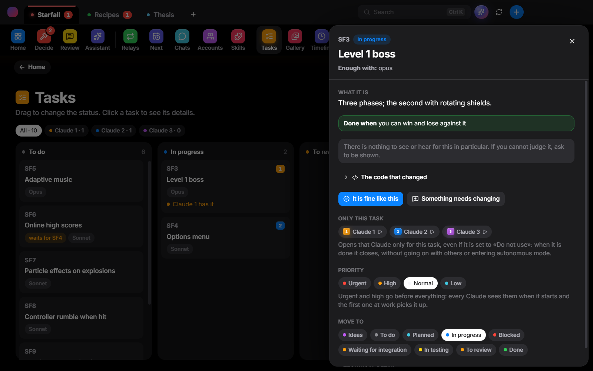
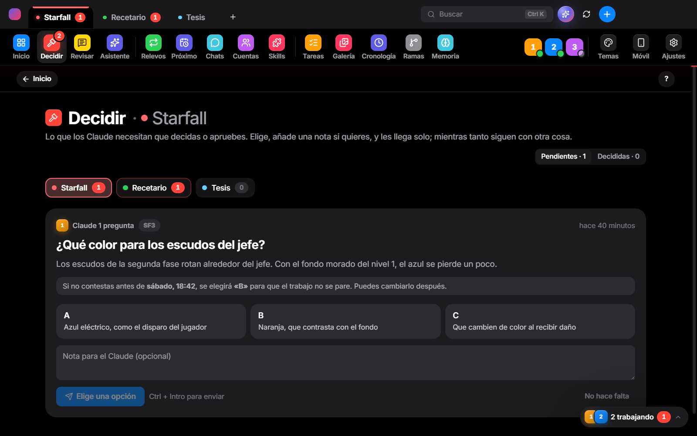
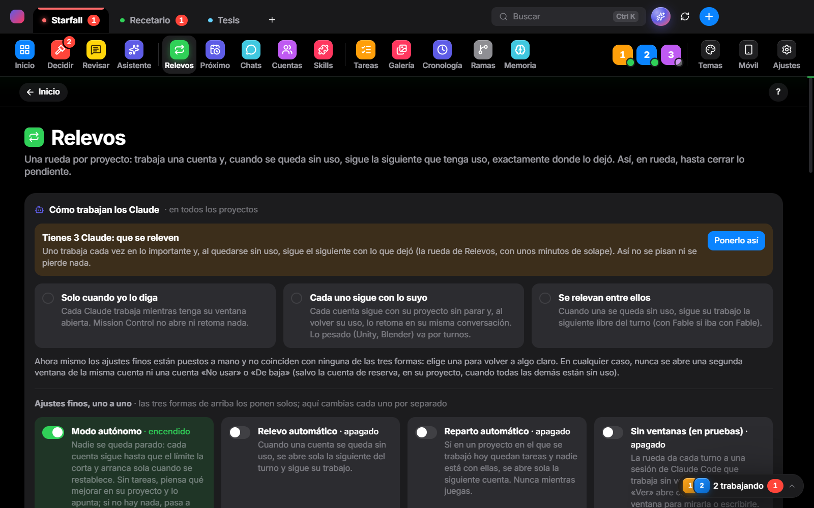
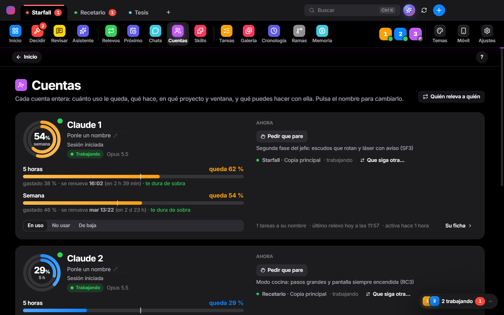
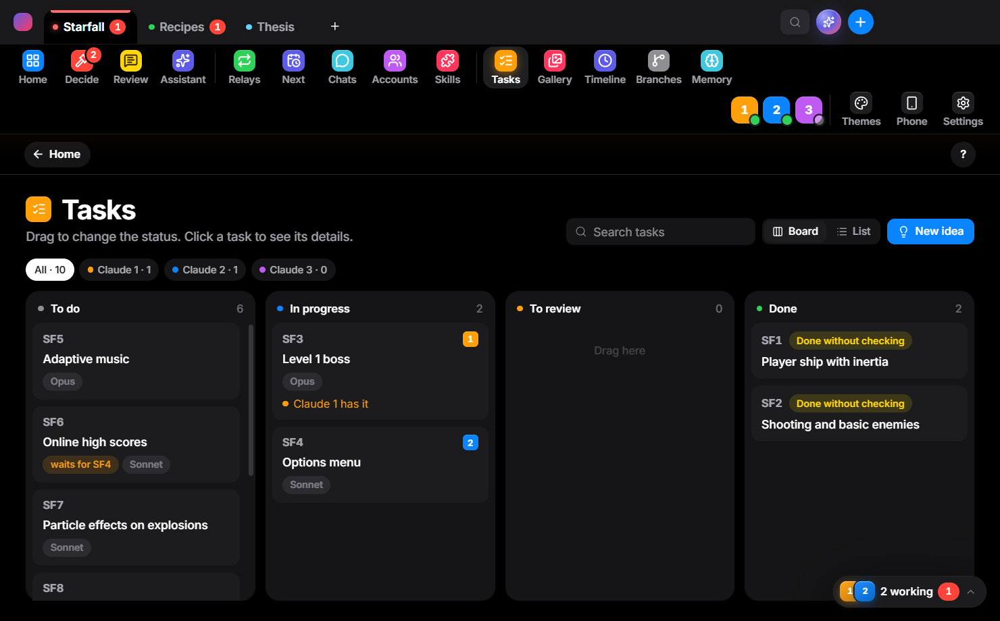

# Mission Control for Claude Code

**A desktop app for Windows that coordinates your Claude Code accounts and projects.** See which Claude is working where, how much usage each one has left, what they are waiting for you to decide, and who carries on when one runs out of usage. It works with one account and gets better with several.

[Leer en español](LEEME.md) · [Buy me a coffee](https://buymeacoffee.com/pakitron.exe)

> The interface is in English and Spanish (Settings › General › Language; by default, your Windows language). The pictures below use made-up data: three accounts and three example projects.

## Why

Claude Code is great at working on its own, but once you run it in more than one window, on more than one project, or with more than one account, you lose track: which session is doing what, which one is stuck on a question, which account still has usage this week, and where the work stopped when a limit cut it. Mission Control keeps that picture for you, on your own PC, and gives every Claude the same simple way to hand work over.

## What it does

- **Every Claude at a glance.** Each account's 5-hour and weekly usage, its open windows and background sessions, and a one-line "now" of what it is working on, updated live from Claude Code's own hooks and status line.
- **Hand-offs between accounts.** When one account runs out of usage, the next one picks up exactly where it stopped: its task, its notes and its working copy. Accounts can take turns on a project (a relay wheel) or each keep to its own. It is off until you turn it on, after the app shows you what Anthropic's terms say.
- **Decisions without stopping the work.** A Claude that needs you leaves a question with options and pictures (`pmc decide`) and goes on with something else. You answer from the PC or the phone, and the answer reaches it at its next step. If you don't answer in time, the default option is taken.
- **Messages straight to a Claude.** Write in the Claudes panel: your note goes into the window of an idle Claude, or reaches the busy one after its current step. Each message shows where it is: waiting, written, read, filed as a task, done.
- **Only this task.** Open any account, even one you keep aside, for a single task. It doesn't go on to other work and its window closes when it's done. If it asked you something and you answer later, it comes back, does what you said, and closes again.
- **Tasks from your repo.** The board is read from `docs/TASKS.md`, so the Claudes and you share one list, with priorities, owners, the model each task needs, and a check that a task is not marked done while its tests fail.
- **Review what they made.** A gallery of every image and video in your projects, with pinpoint comments that go back to the Claude as corrections.
- **Memory that survives compaction.** Rules, preferences and facts every session reads first, and again after its conversation is compacted.
- **Your phone.** The same app as an installable web app through Tailscale, with notifications when a Claude needs you. Nothing is opened to the internet.
- **Built for your PC.** Heavy jobs (Unity, Blender, the GPU) take turns, and the app notices when you are playing or editing video.

| | |
|---|---|
|  |  |
| **The Claudes panel**, on every screen: what each one is doing and your messages with their state. | **Only this task**: open one account for a single task; it closes when it's done. |
|  |  |
| **Decide**: questions from the Claudes, with options and what happens if you don't answer. | **Relays**: how the accounts take turns, and autonomous mode. |
|  |  |
| **Accounts**: usage left, sessions and what each one is on. | **Tasks**, read from each project's `docs/TASKS.md`. |

## Requirements

- Windows 10 or 11.
- A Claude account with Claude Code, on any plan: Pro, Max, Team, Enterprise, or pay as you go (Console, an API key, Amazon Bedrock, Google Vertex). Claude Code only reports how much usage is left on subscription plans. On the others the app knows an account has run out when Claude Code says so, and it never keeps a pay-as-you-go account working on its own.
- Nothing else. If Claude Code is missing, the app installs it with Anthropic's official installer. Node.js is not needed.

## Install

1. Download `Pakitron Mission Control Setup <version>.exe` from [Releases](../../releases) and run it. It is not signed yet, so Windows may warn you: "More info" › "Run anyway".
2. Open **Pakitron Mission Control**. Its first screen walks you through four steps: your Claude accounts, letting the app see what each Claude does (it adds Claude Code hooks, after backing up your `settings.json`), your first project folder, and who carries on when an account runs out.

From source: `npm install`, then `npm run dev` to try it or `npm run dist` to build the installer in `dist\`.

## How the Claudes work with it

Each Claude uses the `pmc` command, which the app sets up in every window:

| Command | What it does |
|---|---|
| `pmc parte` | Where the project stands, what was left in progress and this account's queue. |
| `pmc claim <ID>` / `pmc release <ID>` | Reserve a task so no other account does it, and let it go. |
| `pmc decide "…" --opcion "A: …" --defecto A` | Ask you something without stopping; the answer arrives on its own. |
| `pmc guarda "…"` | Leave the hand-off up to date and commit, at the end of every block of work. |
| `pmc verifica <ID>` | Run the project's checks before a task counts as done. |

Everything is plain files in your project (`docs/TASKS.md`, `docs/RELEVO.md`, `CLAUDE.md`) plus one local database. A Claude without the app can still read and follow them.

## Your data

Everything stays on your PC: the database, the usage readings, the hooks' log. The app reads Claude Code's own files and its documented commands (`claude agents --json`, the status line, hooks). It never reads your credentials and sends nothing anywhere unless you set up the phone, which goes through your own Tailscale network.

## Not affiliated with Anthropic

Mission Control is an independent project, not made or endorsed by Anthropic. Claude and Claude Code are Anthropic's. If you combine several subscriptions, read Anthropic's terms first: the app shows them to you before turning hand-offs on, and you do it under your own responsibility.

## Support

If Mission Control saves you time, you can [buy me a coffee](https://buymeacoffee.com/pakitron.exe). Issues and pull requests are welcome.

## License

[Apache 2.0](LICENSE). Made by Pakitron ([NOTICE](NOTICE)).
